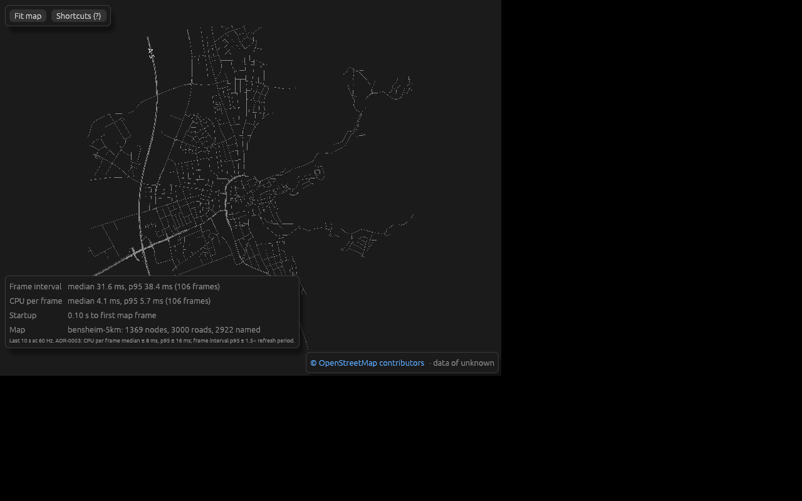
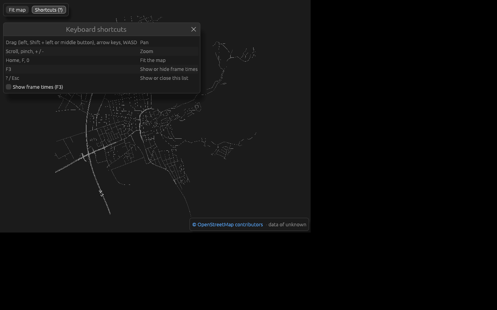

# M1 user trial

Milestone M1 (map viewer) on `main` at 0b4ce39, 2026-10-22, before the 0.2.0
release (AGENTS.md §8, roadmap M1.9). Two parts:

- **Native and CLI:** a trial agent without prior context, using a fresh clone
  and the README only. It ran on a headless Linux box with no GPU, under Xvfb
  with Mesa llvmpipe.
- **Browser:** the maintainer, on the GitHub Pages site. The agents' sandbox
  can't reach `github.io`, so the browser trial agent could not run. The
  maintainer reported startup and frame times and a first look ("looks fine"),
  not a walk through every control.

## Results against the M1 targets

| Check | Target | Result |
| --- | --- | --- |
| Startup, browser, bensheim-5km | ≤ 5 s | Firefox on iOS (WebKit): map in < 2 s. qutebrowser on a laptop (Chromium engine): 0.32 s to first map frame |
| Startup, native, bensheim-5km | ≤ 3 s | 0.09 s to first map frame, window shown 0.03 s after launch (release build, llvmpipe) |
| CPU per frame (ADR-0003) | median ≤ 8 ms, p95 ≤ 16 ms | qutebrowser: median 1.1 ms, p95 1.7 ms. Native on llvmpipe: median 3.8 ms, p95 4.7 ms |
| Frame interval (ADR-0003) | p95 ≤ 1.5× refresh period | Not measured on real hardware. llvmpipe: median 29 ms, p95 43 ms (software rendering, not representative) |
| Street names with ä/ö/ü/ß | readable | "Bahnhofstraße" and others render natively; 2922 of 3000 roads named |
| Touch | works on a real device | Not tested: on Firefox for iOS the map loads; no gestures were reported (carried to the M2 trial) |
| WebGL2 on Firefox and Safari | renders | WebKit (iOS) yes; desktop Firefox not tried |

## What worked

- **CLI:** `cargo run -p rusthour-cli -- run --seed 42 --steps 1000` prints
  JSON with the state hash.
- **Tests:** `cargo nextest run --workspace --all-features` ran 45 tests, all
  passing.
- **Maps:** the published maps downloaded fine, and their SHA-256 matches
  `data/assets.toml`. Importing bensheim-5km from the published extract gives
  a byte-identical `.rhnet` and reports
  `dropped 34 roads not connected to the area's center (3.5 km)`.
- **Importer errors** are clear and exit with 1:
  - an unknown area lists the known ones;
  - a missing or non-PBF input names the file and suggests `osmium cat`;
  - running outside the repository root says to pass `--areas`.
- **Native viewer:**
  - Scroll zoom, left-drag pan, F3 and the "Shortcuts (?)" button work, and
    the OSM attribution shows.
  - A truncated map, a PBF passed as `--map`, and a missing file each give a
    friendly message.

## What was confusing

All of these are fixed in this PR's README update:

- The README's status still said "milestone M0". Nothing said M1 is a map
  viewer with no traffic yet, or that the CLI's `run` only steps an empty
  simulation.
- The quick start used `bensheim-5km.rhnet` before saying where to get it.
- It didn't say the first build takes minutes and GBs, or that the importer
  must run from the repository root.

## Bugs

No blocking bugs among what was tested. Several M1.9 checks were not run in
this trial; the maintainer ran the release-relevant ones on real hardware
(M1.12), and the rest are carried to the M2 trial (see "Not tested"). GitHub issues are disabled for this
repository, so the findings are listed here, with the UX designer's triage:

1. **Every map's source date is "unknown".** The viewer shows
   "data of unknown", because `osmium extract` drops the extract's
   replication timestamp. Fixed in
   [#29](https://github.com/jkorinth/rusthour/pull/29): the assets
   workflow keeps the header, and the viewer hides an unknown date.
2. **`--map` without a value** silently opens the demo grid instead of
   showing the usage. Minor; added to the backlog.
3. **The importer accepts a too-small extract** (1 km of data for the 5 km
   area) without a warning. Added to the backlog: warn when the extract
   doesn't cover the area's bbox.
4. **Minor roads look thin and broken at fit zoom** under llvmpipe. Possibly
   software rendering; to be checked on a real GPU in the M2 trial.

## Real hardware (M1.12)

The maintainer checked these in the browser on a laptop:

- **Load failure:** with the viewer's files blocked, the page shows "Rust
  Hour could not be loaded. Check your connection…" instead of a blank page.
- **Panning:** middle-button drag and Shift + left drag both pan the map,
  without starting the browser's autoscroll.

## Not tested

Carried to the M2 user trial:

- The browser's panic message (no way to trigger a panic from the UI).
- Touch gestures on a real device: one-finger pan and pinch zoom.
- Frame interval on real hardware.
- The browser controls walked through one by one, including the map
  selector, Back and `?map=` handling.
- Whether minor roads look thin and broken at fit zoom on a real GPU (bug 4).
- Native on a real GPU and display, and HiDPI.
- Native window resize, middle and Shift drag, keyboard pan and zoom.
- `?` and Esc (synthetic key presses didn't register).
- The demo grid and the 1 km and 2 km maps natively.
- Desktop Firefox.
