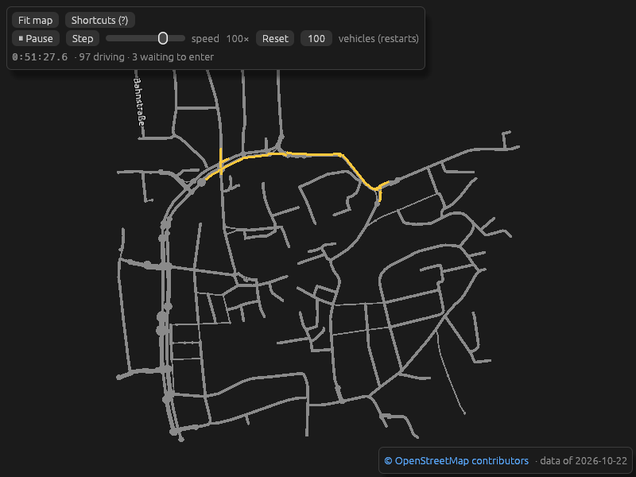
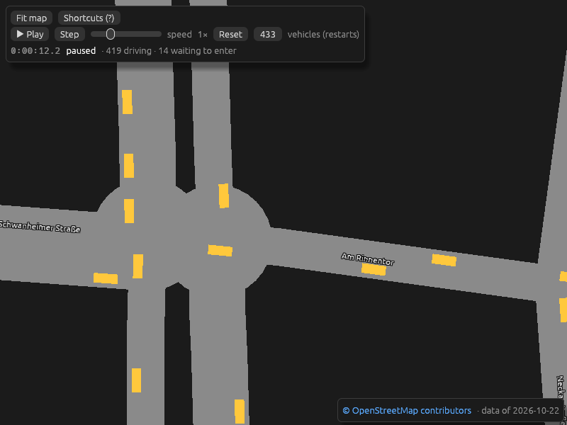
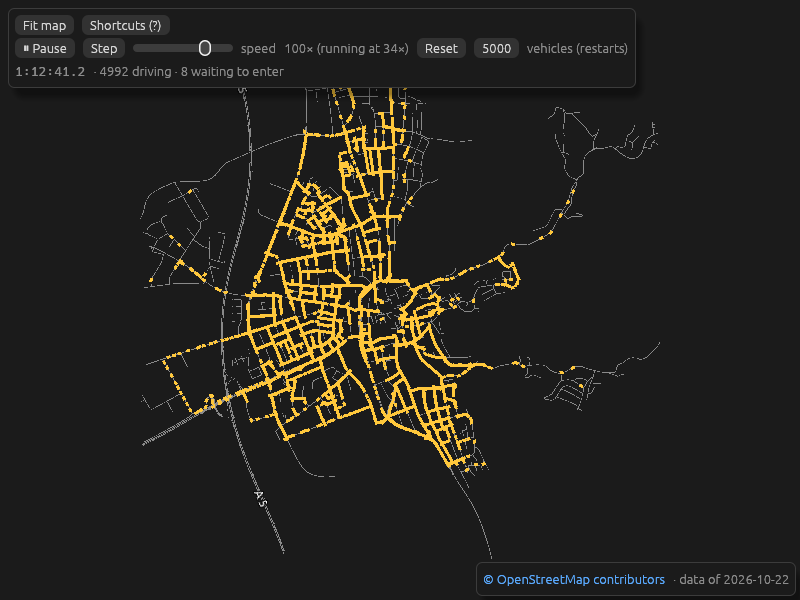

# M2 user trial

Milestone M2 (first traffic), before the 0.3.0 release (AGENTS.md §8). Three
parts:

- **Native and CLI, round 1:** a trial agent without prior context, using a
  fresh clone and the README only, on a headless Linux box without a GPU
  (Xvfb, Mesa llvmpipe). It found a blocking gridlock.
- **Native and CLI, round 2:** the same agent on a fresh clone after the
  fixes (#49, #51, #53, #54, #55).
- **Browser:** the maintainer, on the GitHub Pages site on an iPad. The
  agents' sandbox can't reach `github.io`.

## Round 1: total gridlock (blocking)

Traffic froze completely within 1–20 simulated minutes at every density, and
no vehicle ever arrived. With 100 vehicles on bensheim-1km, all 97 sat in one
queue after 51 s.

Everything else worked: deterministic hashes, clear CLI errors, all viewer
controls, Reset reproducing identical frames, vehicles on the right and
queueing without overlap.

Fixes:

| PR | Fix |
| --- | --- |
| #49 | A car with no room on its next road no longer holds the junction ("don't block the box"). Cause: at OSM junctions split into two nodes by short links, four cars waited on each other in a cycle. |
| #53 (M2.9) | Routes use current travel times, and vehicles under way reroute every 180 s, staggered (perfect information; drivers' limited knowledge is M5.5). Before, every trip took the free-flow route, and a ring of short one-lane roads in the town centre filled. |
| #51 (M2.10) | Safety net: a vehicle stopped for 300 s is removed and counted (minimal part of M3.5). |
| #54 | The viewer starts with one vehicle per 60 m of road instead of 50 m (about 4,000 instead of 5,000 on bensheim-5km), to meet the architect's gate of fewer than 5% removals per arrival. |
| #55 | README updated for M2 (trial findings 3 and 4). |

## Round 2: traffic keeps moving

CLI, 2 simulated hours, seed 42 (arrivals and removals from a local counter;
the API doesn't expose them yet):

| Map, vehicles | Arrived | Removed by the net | Removed per arrival |
| --- | ---: | ---: | ---: |
| bensheim-1km, 100 | 4,378 | 1 | 0.02% |
| bensheim-1km, 500 | 4,273 | 267 | 6.2% |
| bensheim-5km, 4,000 (viewer default) | 9,596 | 338 | 3.5% |
| bensheim-5km, 5,000 | 9,090 | 665 | 7.3% |

- **Moving:** state hashes change at every sample, and viewer screenshots
  never stop changing (5 km at the default and at 5,000 to 1 h 12 min; 1 km
  to 1 h 35 min).
- **Speed:** 4,000 vehicles on 5 km run at about 1,925 steps/s (190× real
  time), 5,000 at about 1,573 steps/s (157×).
- **Plausibility:** traffic spreads over the whole network including the
  outskirts, and vehicles cross junctions without overlapping. No vehicle
  was seen vanishing on screen, though the counters show 2–5 removals per
  simulated minute in the dense runs.
- **No regressions** against round 1.

## Browser (maintainer, iPad)

- **Startup:** cars appear about 5 s after opening the site (bensheim-5km).
- **Smoothness:** very smooth, no stutter, also at high speeds; traffic keeps
  flowing.
- **Frame times:** not measured, since there is no F3 key on an iPad.

## Findings

None blocking. GitHub issues are disabled, so they are listed here and in the
roadmap backlog:

1. **Heavy congestion at the default density.** Trips take 50–66 simulated
   minutes at 4,000–5,000 vehicles, against about 4.5 at 200, and throughput
   falls slightly at high density. Demand keeps the number of vehicles
   constant, so trip time is roughly vehicles ÷ throughput (4,000 ÷ 4,800
   per hour ≈ 50 min). Lane changes and signals (M3) may raise throughput,
   but won't by themselves make dense runs fast; re-measure after M3.
2. **Removals are invisible.** Nothing user-facing shows the stuck-net
   count. Expose it in the API, the CLI and the viewer (M3.5).
3. **The 4-arm roundabout on Berliner Ring causes many removals**
   (maintainer). M2 roundabouts are one lane wide and don't model their real
   capacity, and when an exit backs up, the queue spills into the ring until
   it locks. Real roundabouts rarely lock, but they can under spillback.
   Part of it is a rule artefact (architect): the "no room" rule from #49
   also applies to vehicles already circulating and reads start-of-step
   positions, so a moving ring whose road tails are each within one car
   length looks fully blocked. Candidate fix: don't apply "no room" to heads
   already on the ring, then re-measure Berliner Ring (M3.5); also re-check
   with lanes and turn lanes (M3.1, M3.4).
4. **A short, wide approach to a Berliner Ring roundabout slows traffic**
   (maintainer). In reality it is a straight road that splits into two lanes
   before the roundabout. Probably how the importer turns the OSM ways there
   into one-lane roads with short links; investigate the OSM data.
5. **Nodes are drawn as large circles at high zoom**, which looks odd now
   that cars move past them (maintainer).
6. **Zoom has no limit**, so vehicles become screen-sized at maximum zoom.
7. **A schema mismatch reads "not a Rust Hour map, or damaged"** before the
   correct detail line.
8. **The 5 km map fills slowly at startup** (at most 8 new trips per step).

## Not tested

- Frame times in a browser (no F3 on the iPad), desktop browsers, a real GPU
  natively.
- Touch gestures were used but not checked one by one.
- Two hours in the viewer (the CLI covered it).
