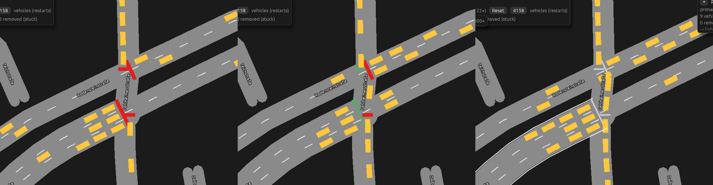
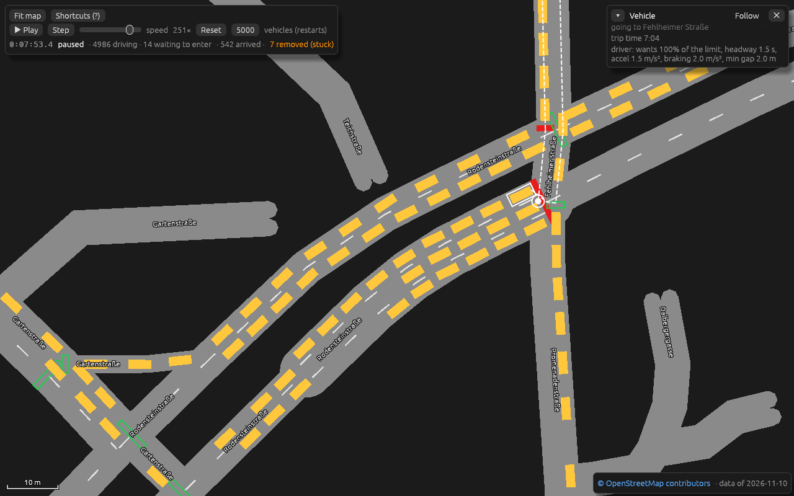
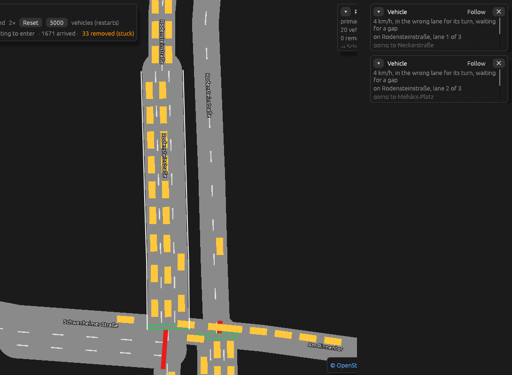

# M3 user trial

Milestone M3 (lanes and intersections), before the 0.4.0 release (AGENTS.md
§8). A trial agent without prior context, using a fresh clone of `main` at
`98045b2` and the README only, on a headless Linux box without a GPU (Xvfb,
Mesa llvmpipe, 2 cores). Maps: the newest assets pre-release,
`assets-2026-11-11` (SHA-256 in the file names checked).

- **CLI:** the README example, 2-hour runs on all three maps at several
  densities with `--report-stuck`, determinism, bad input.
- **Native viewer:** bensheim-5km at the default 4,158 and at 5,000
  vehicles: signals, lanes, signs, speeds past 30×, zoom limits, scale bar,
  selecting cars and roads, following a car, frame times, the vehicle count
  field, and a 2-hour run (what M2 left untested).
- **Browser:** not tested. `rustup target add wasm32-unknown-unknown` fails
  in this sandbox ("unsuccessful tunnel" to static.rust-lang.org), there is
  no browser to open a build in, and `github.io` is blocked.

## CLI

The README example runs in 1.8 s and prints `arrived`, `removed_stuck` and
`removed_per_arrival` next to the state hash. The same seed gives the same
hash on every run, another seed another hash. `rusthour run --help`
documents `--report-stuck`, which adds the ten roads with the most stuck
removals, each with road id, street name, OSM way and whether it is a
roundabout. One unnamed road shows `"name": null` with its OSM way, which is
enough to look it up.

2 simulated hours (72,000 steps), seed 42, `--report-stuck`; M2 round 2 in
brackets:

| Map, vehicles | Arrived | Removed by the net | Removed per arrival | Roads with removals |
| --- | ---: | ---: | ---: | ---: |
| bensheim-1km, 100 | 3,550 (4,378) | 0 (1) | 0% (0.02%) | 0 |
| bensheim-1km, 500 | 4,941 (4,273) | 129 (267) | 2.6% (6.2%) | 26 |
| bensheim-2km, 1,000 | 8,444 | 140 | 1.7% | 21 |
| bensheim-5km, 2,000 | 12,773 | 12 | 0.09% | 11 |
| bensheim-5km, 4,000 | 12,308 (9,596) | 142 (338) | 1.2% (3.5%) | 50 |
| bensheim-5km, 5,000 | 11,931 (9,090) | 165 (665) | 1.4% (7.3%) | 62 |

- **Gridlock gate met:** at 5,000 vehicles, 1.4% removals per arrival and
  about 5,970 arrivals per hour (gate: at most 5% and at least 4,545).
- **Hotspots:** Rodensteinstraße appears two or three times in every 5 km
  top ten (roads 359, 2424, 1071), next to Neckarstraße,
  Elisabethenstraße and Fichtestraße. Road 2028 wasn't in the top ten for
  seed 42.
- **Speed:** the first 30 simulated minutes on bensheim-5km run at about
  1,300 steps/s with 4,000 vehicles (130× real time) and 1,040 with 5,000,
  against 1,925 and 1,573 in M2 round 2 (finding 16).
- **Errors:** a missing file, a directory, a non-map file ("not a .rhnet
  map file (wrong magic bytes)"), a negative count and a non-numeric seed
  all give a clear one-line message and exit code 1 or 2. `--dt-ms 0`
  panics (finding 2).

## Native viewer

Everything the release notes list is there and works:

- **Signals:** red bars across the stop line, green as a hollow outline,
  amber in between, changing in plan; at the Rodensteinstraße /
  Fehlheimer Straße junction the phases rotate and queues discharge. Above
  30× the bars turn neutral grey, and paused they show colours again.
  Hovering a bar shows a tooltip, e.g. "Signal: green, amber in 15 s".
- **Lanes:** lane dividers on multi-lane roads, cars centred in their lanes,
  queues in two or three lanes. The lane-change slide was too quick to catch
  in still screenshots.
- **Signs:** give-way triangles at road ends when zoomed in. No stop or
  priority sign was in view in the areas looked at.
- **Roads:** rounded road ends instead of node discs (M2 finding 5 fixed).
- **Zoom:** stops at a 2 m scale bar (cars about 50 px wide) and at a
  little less than the whole map (M2 finding 6 fixed). The scale bar
  updates with zoom.
- **Counters:** arrived and removed (stuck) in the status line, removed in
  orange once non-zero; roads with removals get a red line.
- **Selecting:** a click selects a car or road. The car panel shows speed
  and why it waits ("at the signal: red, green in 7 s", "stuck in a queue",
  "giving way", "in the wrong lane for its turn, waiting for a gap"), road
  and lane ("lane 3 of 3"), destination, trip time and the driver
  parameters; its route ahead is drawn dashed to a destination marker. The
  road panel shows class, lanes, limit, length, vehicles and mean speed,
  removals, the delay per movement against the expected delay, and the
  signal state.
- **Following:** C or "Follow" keeps the car centred while it drives
  through several streets, with a hint "follow works best below 30×"; Esc
  stops following and clears the selection.
- **Frame times (F3):** at 5,000 vehicles, frame interval median 25 ms, p95
  36 ms, 1.7 ms per simulation step, 0.16 s to the first map frame.
- **Vehicle count field:** "abc" is ignored, 0 empties the map, 999,999 is
  capped at 100,000.
- **Long run:** at the default 4,158 vehicles and 1,000× requested (11–20×
  reached on llvmpipe), the viewer ran to 2 h 51 min with 17,482 arrivals
  and 187 removals (1.1%), traffic still moving everywhere and a dozen
  roads marked red for removals.

### Cars wait in the wrong lane at the line

At 5,000 vehicles after 20 minutes, southbound Rodensteinstraße queues for
several hundred metres from the signal at Schwanheimer Straße / Am Rinnentor
back past Gartenstraße. On the three-lane approach (68 m, 20 vehicles, mean
2 km/h) the first car in lane 1 and in lane 2 both read "in the wrong lane
for its turn, waiting for a gap"; only lane 3 discharges. 50 simulated
seconds later the front cars had changed but lane 2's again read "wrong
lane", while the signal showed green and the junction was nearly empty. A
car picked at random in the queue was 19 minutes into its trip with its
destination 80 m ahead. Spillback from the Am Rinnentor exit adds to it.

## Findings

GitHub issues are disabled, so they are listed here. Blocking is the trial
agent's suggestion; the maintainer decides.

1. **Bug, high, not blocking (gate met): cars stuck in the wrong lane at
   the line.** On the three-lane southbound Rodensteinstraße approach to
   Schwanheimer Straße, two of three lanes are held by front cars waiting
   for a gap to change lanes, at green, so the approach runs on one lane
   and the queue spills back through the next junction. Same corridor as
   the known hotspot (road 2028); Rodensteinstraße also leads the CLI's
   removal lists. Lane choice probably needs to happen earlier, or a car
   that can't change should go ahead and re-plan sooner.
2. **Bug, low: `--dt-ms 0` panics** with "attempt to divide by zero" in
   `Engine::with_network` and exit code 101. Very large steps are accepted
   silently: `--dt-ms 100000` (100 s per step) runs and reports 8 arrivals
   after 3 steps. Reject 0 and cap the step with a message.
3. **UX/docs, medium, recommended before release: the README describes
   M2.** The status line still says "milestone M2 … Lane changes and
   traffic lights come with M3". Controls don't mention click or tap to
   select, C to follow, Esc, or what signal bars and red road lines mean
   (the in-app shortcut list has some of this). `--report-stuck` and the
   new JSON fields aren't mentioned.
4. **UX, medium: CLI road ids can't be found in the viewer.** The CLI
   reports roads by id and OSM way (e.g. road 2635, way 641647725), but the
   viewer's road panel shows neither, and there's no way to jump to a road
   id. A user can't check a hotspot from the CLI in the viewer. Show the id
   and OSM way in the road panel, or accept `--road <id>` / a search field.
5. **UX, medium: the selection panel shows about four lines.** Movement
   delays, the signal state and the driver line need scrolling with a thin
   scrollbar that is easy to miss. Once a car panel opened already scrolled
   past its first line, which hid the speed and the reason it waits. Let
   the panel grow to its content, or put speed and the reason first.
6. **UX, low: "driving freely" at 1 km/h.** Front cars at a green signal,
   barely moving, read "1 km/h, driving freely". That says nothing about
   why they're slow (accelerating from a stop? blocked inside the
   junction?).
7. **UX, low: signals turn neutral by the requested speed, not the speed
   reached.** At "251× (running at 22×)" the bars are neutral, though the
   simulation is under 30× and colours would still be readable.
8. **UX, low: the controls panel changes width** with the speed readout
   ("2×" vs "1000× (running at 11×)") and the follow hint, so Reset and the
   vehicle field move sideways under the pointer.
9. **UX, low: the shortcut list covers the selection panel**, both at the
   top right.
10. **UX, low: one scroll notch about doubles the zoom**, so 8 notches go
    from the whole town (500 m bar) to the 2 m limit. Easy to overshoot
    into an empty spot.
11. **Question for the architect: fewer arrivals at low density.**
    bensheim-1km with 100 vehicles: 3,550 arrivals in 2 h against 4,378 in
    M2 (−19%), with no removals in either. Maybe the expected cost of
    signals, give-way and turn costs; worth confirming it's not lost
    capacity at a junction.
12. **Minor: a removal on a quiet outskirts road** (Im Heckengrund, one
    lane, no other vehicles near) at 5,000 vehicles. The panel says "1
    removed (stuck)" but not why; a last reason (what it waited for) would
    help.
13. **Minor: two cars drawn overlapping inside a junction** at maximum zoom
    (Rodensteinstraße / Fehlheimer Straße, a turning car across a car going
    straight). Seen once.
14. **Minor, still open from M2 (finding 8): the 5 km map fills slowly.**
    3,582 of 4,158 vehicles still wait to enter at 7 s, all are in after
    about a minute.
15. **Observation: the A5 motorway carries no traffic** at any density.
    Possibly by design (no trip benefits from it inside the area), but it
    looks odd next to a jammed town centre.
16. **Question for the architect: the CLI is about a third slower than in
    M2** (1,300 against 1,925 steps/s at 4,000 vehicles, 1,040 against
    1,573 at 5,000). Lanes, signals and MOBIL cost something, and this box
    may be slower than M2's, so a benchmark on one machine should decide.

## Not tested

- The browser build (no wasm target, no browser, `github.io` blocked), so
  the map selector (browser only) and real touch input; xdotool can't
  generate touch events.
- Stop and priority signs on screen; the lane-change slide frame by frame.
- A real GPU; frame times were measured with llvmpipe only.

## Answers

From M3.12 (PR #81), for the findings that needed no code change:

- **11, fewer arrivals at low density** (1 km, 100 vehicles, 3,550 against
  4,378): the same 100 cars take about 23% longer per trip (Little's law).
  They move 89.6% of the time; 7.1% of the time they stand at a red light
  (M2 had no signals), 2.2% wait for room and 0.4% give way. No removals
  and no wrong-lane waits, so the cause is signals, not lost capacity.
  Across seeds 42 and 1–4 the arrivals vary from 3,316 to 3,550.
- **12, a removal on quiet Im Heckengrund:** reproduced with seed 0 at
  5,000 vehicles, at about 6 minutes. While the map fills, Gronauer Straße
  backs up, and the queue on Im Heckengrund waits the full 300 s for room
  to enter it. By the time someone looks, the street is quiet again. A
  "last reason" in the removal report would make this visible.
- **15, the A5 carries no traffic:** not a bug. Inside the area the A5 has
  a single interchange (Bensheim), and each carriageway enters or leaves at
  the map edge. So no A5 road is in the router's strongly connected set:
  demand never picks one as an origin or destination, and an in-area trip
  can't use it, because once on it a car can only leave the map. The
  dead-end ramps further out lead to rest areas (`highway=service`, not
  imported). Through traffic needs edge-to-edge demand (M6 scenarios).
- **16, the CLI is about a third slower than in M2:** on one machine,
  v0.3.0 on its own map runs the first 30 minutes of bensheim-5km at 1,715
  steps/s with 4,000 vehicles and 1,309 with 5,000; M3 runs at about
  1,300–1,400 and 1,141. So M3 costs about 13–19%, and the rest is a slower
  machine. Timings vary by ±10% between runs.
