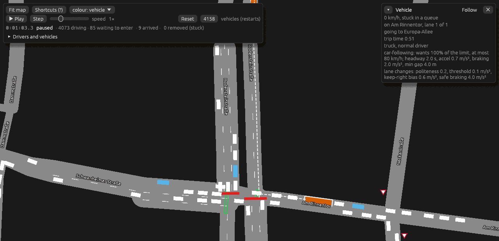
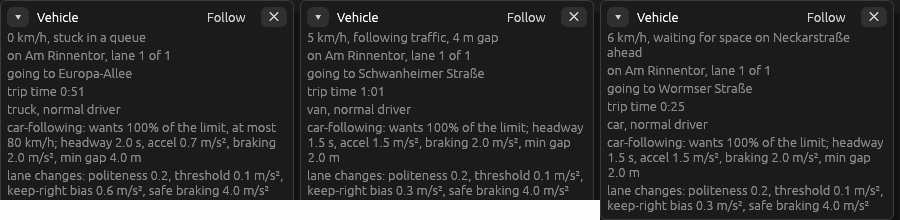
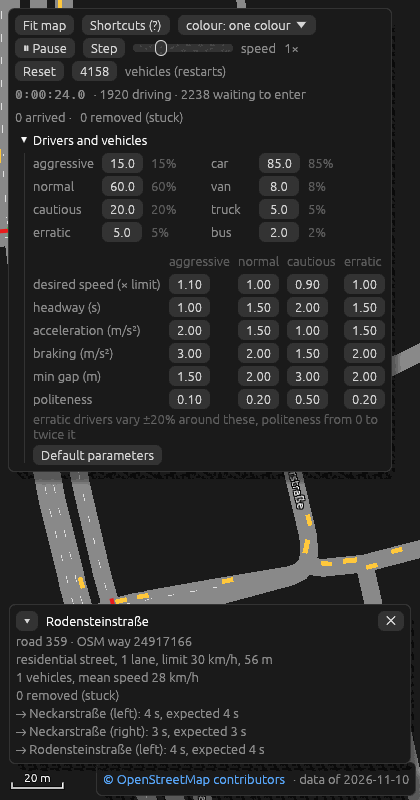
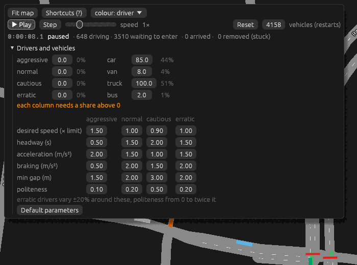
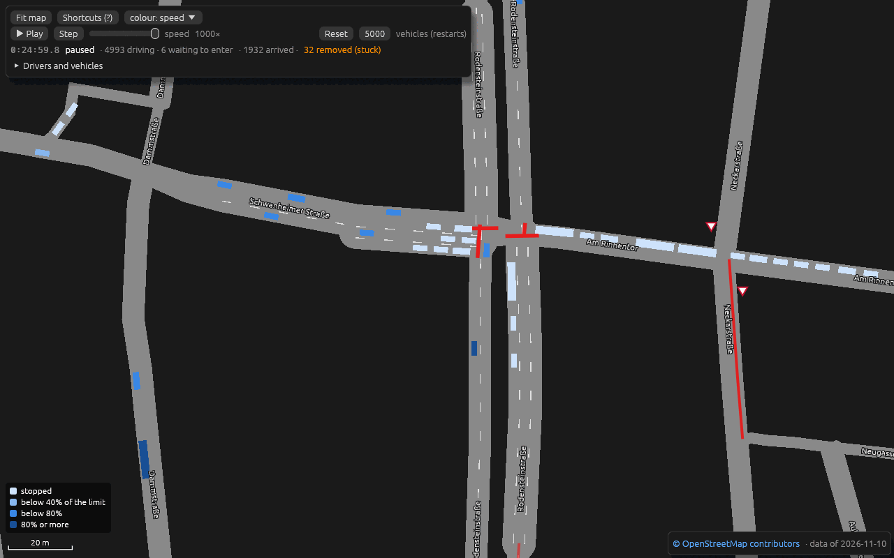

# M4 user trial

Milestone M4 (drivers and vehicles), before the 0.5.0 release (AGENTS.md
§8). A trial agent without prior context, using a fresh clone of `main` at
`808ff87` and the README only, on a headless Linux box without a GPU (Xvfb,
Mesa llvmpipe, 2 cores, `RUSTUP_TOOLCHAIN=stable`). Maps: the newest assets
pre-release, `assets-2026-11-11` (SHA-256 in the file names checked).

- **CLI:** the README examples, `--drivers` and `--fleet` with the default
  and extreme mixes (all trucks, all buses, all erratic, all aggressive, all
  cautious), bad syntax, 2-hour runs with `--report-stuck` on all three
  maps, determinism, speed.
- **Native viewer:** bensheim-5km at the default 4,158 and at 5,000
  vehicles: the three colour modes and their legends, a truck, a van and a
  car side by side, editing the mix and the parameter table and applying
  with Reset, `--road`, a 420 px window, the version label, following a
  vehicle, trucks and erratic drivers on screen, and the M3 hotspots
  (Rodensteinstraße / Schwanheimer Straße, Wormser Straße).
- **Browser:** not tested. `rustup target add wasm32-unknown-unknown`
  fails in this sandbox ("unsuccessful tunnel" to static.rust-lang.org),
  there is no browser here to open a build in, and `github.io` is blocked.

## Getting started

The README got me from clone to a running CLI and viewer without
guessing: maps from the newest `assets-*` pre-release, then
`cargo run -p rusthour-cli --release -- run --map …`. The release build
took 5.5 minutes. The README's status box still says "milestone M3 …
Driver and vehicle types come with M4" (finding 1), but the "Command line"
and "Viewer" sections already describe `--drivers`, `--fleet`, the colour
modes and the "Drivers and vehicles" section, so a careful reader finds
everything.

## CLI

The README example runs in 1.6 s and now echoes the mixes, normalised to
sum to 1:

```json
"drivers": { "aggressive": 0.15, "cautious": 0.2, "erratic": 0.05, "normal": 0.6 },
"fleet": { "bus": 0.02, "car": 0.85, "truck": 0.05, "van": 0.08 },
```

`rusthour run --help` lists both options with their defaults. Same seed,
same hash, with any mix; `car=3,truck=1` and `car=0.75,truck=0.25` give the
same hash, as the README promises ("only the ratios matter").

**Bad input** is handled well. Every case below exits with code 2 and a
one-line message that names the problem:

| Input | Message (after "invalid value … for '--drivers'/'--fleet'") |
| --- | --- |
| `normal=0,erratic=0`, `car=0` | at least one share must be above 0 |
| `normal=-1` | normal must be a number ≥ 0, got -1 |
| `normal=abc` | normal: "abc" is not a number |
| `normal`, `""`, `car=1,` | "normal" / "" is not name=share |
| `sporty=1` | unknown driver profile "sporty"; use aggressive, normal, cautious, erratic |
| `Car=1` | unknown vehicle class "Car"; use car, van, truck, bus |
| `normal=1,normal=2` | normal is given twice |
| `car=NaN`, `car=inf` | car must be a number ≥ 0, got NaN / inf |
| `car=1e400` | car must be a number ≥ 0, got inf (finding 9) |

`"car = 1"` with spaces is accepted. `--fleet truck=1` without `--map` runs
(no vehicles, the mix is still echoed); `--vehicles 5` without `--map`
says "--vehicles needs a road network: add --map <file.rhnet>". `--dt-ms
0` is now rejected ("0 is not in 1..=1000", M3 finding 2 fixed). A tiny
share like `truck=1e-320` is echoed as `1e-320`, which is correct but odd
to read.

**2 simulated hours** (72,000 steps), seed 42, `--report-stuck`; M3 trial
in brackets:

| Map, vehicles, mix | Arrived | Removed | Removed per arrival | Roads with removals |
| --- | ---: | ---: | ---: | ---: |
| 1km, 500, default | 4,397 (4,941) | 21 (129) | 0.48% (2.6%) | 12 |
| 2km, 1,000, default | 7,627 (8,444) | 34 (140) | 0.45% (1.7%) | 14 |
| 5km, 4,000, default | 11,143 (12,308) | 56 (142) | 0.50% (1.2%) | 38 |
| 5km, 5,000, default | 10,612 (11,931) | 132 (165) | 1.24% (1.4%) | 84 |
| 5km, 4,000, cars, normal drivers | 13,272 | 78 | 0.59% | – |
| 5km, 5,000, cars, normal drivers | 12,331 | 203 | 1.65% | – |
| 5km, 4,000, all erratic | 11,881 | 59 | 0.50% | 42 |
| 5km, 4,000, all trucks | 4,048 | 1,809 | **44.7%** | 503 |

- **Fewer removals:** about a third to a fifth of M3's at the same
  density. With only cars and normal drivers (closest to M3), arrivals are
  3–8% above M3's; the default mix costs about 16% of the arrivals, which
  fits slower trucks and buses and 20% cautious drivers.
- **Hotspots moved:** Rodensteinstraße no longer leads the 5 km lists;
  Starkenburgstraße, Konrad-Adenauer-Straße, Hermannstraße and
  Elisabethenstraße do.
- **All trucks:** 4,000 trucks gridlock the 5 km map (finding 4). At 500
  and 1,000 trucks there are a few removals (2 and 6 in 2 hours) where
  cars have none, mostly on the same Fichtestraße roads (1568, 1570,
  1571, a 7 km/h living street onto Heidelberger Straße) and road 2134
  (Konrad-Adenauer-Straße). Trucks arrive at about half the rate of cars
  even at 500 vehicles (4,585 against 8,600), buses at 69%.
- **All erratic:** no harm: 11,881 arrivals, as many removals as the
  default mix.
- **Speed:** the first 30 simulated minutes on bensheim-5km run at 1,832
  steps/s with 4,000 vehicles and 1,643 with 5,000 (M3 trial: 1,300 and
  1,040; same kind of box). Route planning did get faster.
- **`stuck_roads`** entries carry a `removed` count that the README doesn't
  list (it names `road`, `name`, `osm_way`, `roundabout`); finding 10.

## Native viewer

Everything the release notes list is there and works:

- **Colour modes:** "colour: one colour" (the default, as in M3), speed,
  driver and vehicle. Each mode shows a legend at the bottom left: "car,
  van, truck, bus"; "normal, cautious, aggressive, erratic"; "stopped,
  below 40% of the limit, below 80%, 80% or more". In speed mode, stopped
  cars are the palest, most visible shade, which shows queues at a glance
  (screenshot below).
- **Vehicle sizes:** zoomed in, a truck is about 12 m long against a car's
  4.5 m, buses about as long as trucks, vans in between. All trucks keep
  their lane, and on Schwarzwaldstraße (two lanes each way) the trucks
  seen were in the right lane.
- **Vehicle panel:** class and profile in one line ("truck, normal
  driver"), then car-following and lane-change parameters. Truck and car
  differ as expected: the truck has "at most 80 km/h", headway 2.0 s,
  accel 0.7 m/s², min gap 4.0 m and keep-right bias 0.6; a normal car has
  1.5 s, 1.5 m/s², 2.0 m and 0.3. A normal van reads exactly like a normal
  car. An erratic driver shows its own drawn values (e.g. "wants 102% of
  the limit, headway 1.7 s"). The length isn't shown (finding 6).
- **Drivers and vehicles:** a share per name with its percentage, a
  per-profile table (desired speed, headway, acceleration, braking, min
  gap, politeness) and "Default parameters". After an edit, a line says
  "'Reset' starts over with these settings"; Reset applies them, e.g.
  trucks only, and the map fills with trucks. Values are clamped
  (desired speed at most 1.5, headway and braking at least 0.5; a share of
  300 becomes 100). All four driver shares at 0 shows an orange "each
  column needs a share above 0", but Reset still restarts (finding 2).
- **`--road <id>`:** `--road 359` and `--road 2028` open centred on the
  road with its panel open and a bold white outline. `--road 99999` shows
  "There is no road "99999" on this map; road ids go from 0 to 2999." with
  OK; that note sits over Reset and the vehicle count (finding 11).
- **Narrow window (420 px):** the controls wrap into three rows, the
  "Drivers and vehicles" table fits, and the selection panel moves to the
  bottom. Nothing is cut off.
- **Version label:** "Rust Hour v0.4.0 · dev · 5a7ceea" at the bottom of
  the shortcut list, matching my checkout's commit.
- **Following:** "Follow" keeps the vehicle centred; the header reads
  "Vehicle · following". At 1000× (running at 36–38×) the hint "follow
  works best below 30×" appears, as it should by the speed reached; at 1×
  it doesn't. The hint is very small (finding 12).
- **Route line:** dashed along the vehicle's lane and through the junction
  into the right carriageway of a dual road.
- **Erratic drivers:** a followed erratic car sped up 16 → 24 km/h and
  closed on a queue 33 → 3 m in steps of 1–4 km/h per second; smooth, not
  jerky.







### Mix edits with an invalid driver mix

With all four driver shares at 0 and trucks at 100, the warning shows, but
Reset still restarts: the fleet edit takes effect (many trucks on the
map), while the drivers come out mixed (normal, cautious, aggressive,
erratic all on screen), evidently the previous or default driver mix. The
fields still read 0 and nothing says which mix is running.



### M3 leftovers

- **Rodensteinstraße / Schwanheimer Straße:** at 5,000 vehicles after 25
  simulated minutes, the southbound three-lane approach is nearly empty and
  no car reads "in the wrong lane". M3 finding 1 didn't reproduce. The
  queue is now eastbound on Am Rinnentor, from the signal back past
  Neckarstraße to Mohács-Platz; cars in it are 24 minutes into their
  trips. Neckarstraße, Mathildenstraße and the northbound Rodensteinstraße
  south of the junction are marked red for removals.
- **Wormser Straße:** the through lanes run straight past the turn pockets
  (no zig-zag). Where a pocket starts, the road surface has a rounded step
  at its edge, purely cosmetic.
- **At 5,000 vehicles** most side streets in the centre are full of
  stopped or slow cars after 25 minutes (speed colours), though the CLI's
  removal rate is only 1.2%.



## Findings

GitHub issues are disabled, so they are listed here. Blocking is the trial
agent's suggestion; the maintainer decides. None is blocking.

1. **Docs, medium, recommended before release: the README status box
   describes M3.** It says "milestone M3 … Driver and vehicle types come
   with M4". The sections below it are up to date.
2. **UX/bug, medium, not blocking: Reset with an invalid driver mix
   restarts with a hidden mix.** With all driver shares at 0, the warning
   shows, but Reset restarts anyway with the fleet edits and the previous
   or default driver mix, while the fields still read 0. Disable Reset (and
   the vehicle count) while the mix is invalid, or say which mix it falls
   back to.
3. **UX, medium: the colour palettes reuse the same four colours with
   different meanings.** White, blue, orange and green are car, van, truck,
   bus in vehicle mode and normal, cautious, aggressive, erratic in driver
   mode, so after switching modes an orange truck looks like an aggressive
   driver. The green for buses and erratic drivers is also the colour of
   green signal outlines. Distinct palettes, or shape and length alone for
   class, would help.
4. **Question for the architect, medium: trucks gridlock early.** 4,000
   trucks on bensheim-5km: 45% removals per arrival (cars: 0.6%); 2,000
   trucks: 54 removals in 1 hour (cars: 2). Partly expected (a truck takes
   about three cars' room), but at 500 and 1,000 trucks there are still a
   few removals where cars have none, repeatedly on Fichtestraße roads
   1568/1570/1571 (a 7 km/h living street onto Heidelberger Straße) and
   road 2134. Worth checking whether trucks can wait forever for a gap
   there. Repro: `rusthour run --map bensheim-5km.rhnet --vehicles 500
   --steps 72000 --fleet truck=1 --report-stuck`.
5. **Question for the architect, low: trucks take about twice as long as
   cars** at low density (4,585 against 8,600 arrivals in 2 hours with
   500 vehicles on 5 km; buses 5,912). In a 30–50 km/h town the 80 km/h
   cap doesn't bind, so this comes from acceleration (0.7 m/s²) and
   headway. Plausible, but twice seems a lot.
6. **UX, low: the vehicle panel doesn't show the class's length** (or, for
   car and van, any class limit). A normal van's panel reads exactly like a
   normal car's, so a user can't tell what "van" changes. A line such as
   "van, 5.5 m, normal driver" would answer it.
7. **UX, low: fast vehicles are hard to see in speed mode.** "80% or more"
   is dark blue on the grey road, and erratic green in driver mode is also
   low-contrast at town zoom. Stopped is the most visible shade by design,
   but moving traffic nearly disappears.
8. **UX, low: long vehicles are drawn as straight rectangles in turns,**
   so a turning truck pokes across the junction and overlaps queued
   vehicles on the cross street (seen at Am Rinnentor / Mohács-Platz).
9. **UX, low: `car=1e400` reports "got inf".** The user typed 1e400, so
   "too large" or echoing the input would be clearer.
10. **Docs, low: `stuck_roads` entries have a `removed` field** that the
    README's field list leaves out.
11. **UX, low: the unknown-road note covers Reset and the vehicle count.**
    It appears at the top over the controls until OK is pressed.
12. **UX, low: the follow hint is tiny** (smaller than the other text) and
    makes the controls panel grow by a line, so "Drivers and vehicles"
    moves down.
13. **UX, low: "1 vehicles, mean speed 28 km/h"** in the road panel; the
    singular is missing.
14. **UX, low: different orders of profiles.** The CLI, README and mix
    table list aggressive, normal, cautious, erratic; the driver legend
    lists normal, cautious, aggressive, erratic.
15. **UX, low: the viewer takes no `--vehicles`, `--drivers`, `--fleet` or
    `--version`.** A CLI run can't be reproduced in the viewer from the
    command line, and `rusthour-viz --version` is "unexpected argument"
    (`rusthour --version` works). Without a display it prints a raw debug
    error (`WinitEventLoop(Os(OsError { … "neither WAYLAND_DISPLAY nor
    WAYLAND_SOCKET nor DISPLAY is set." }))`).
16. **UX, low: no way to find a street by name.** Finding Wormser Straße
    took several minutes of panning and clicking; clicks at overview zoom
    pick vehicles, not roads. A search box, or `--road` taking a name,
    would help.
17. **Minor, still open from M3 (finding 8): the controls row shifts**
    when "Pause" becomes "Play", moving Reset and the vehicle count about
    5 px under the pointer.

## Not tested

- The browser build (no wasm target, no browser, `github.io` blocked), so
  `?road=<id>`, the map selector and touch input.
- A real GPU; the viewer reached 36–38× on llvmpipe at 5,000 vehicles.
- Trucks against their 80 km/h cap: no road in the area with a higher
  limit carried traffic (B 47 is 80 km/h and empty, the A5 carries none,
  see M3 answer 15).
- Lane changes frame by frame, and stop and priority signs beyond those
  seen in passing.
